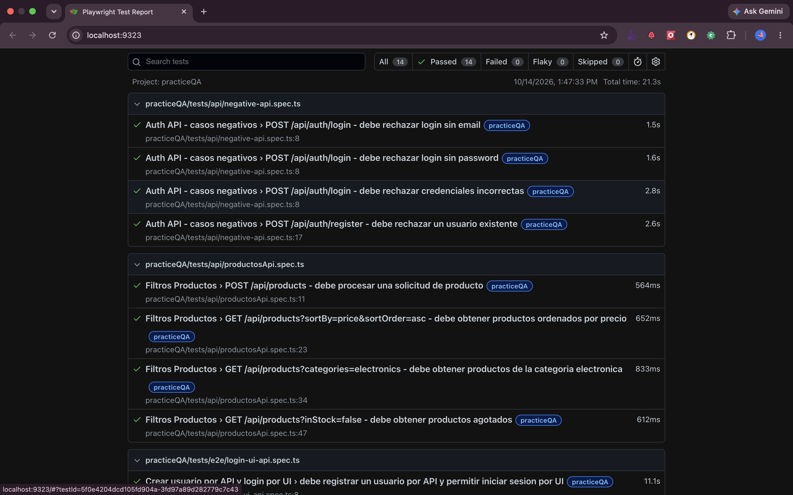
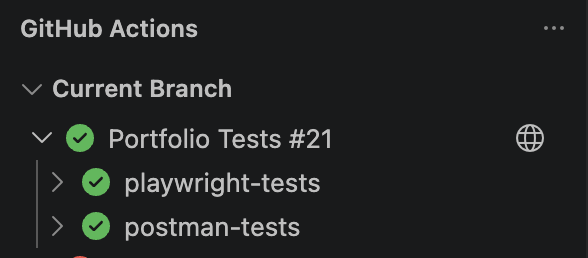

# QA Automation Framework — Playwright, TypeScript & Postman

[](https://github.com/cirleyn09/qarepository/actions/workflows/playwright.yml)
[](https://playwright.dev/)
[](https://www.typescriptlang.org/)
[](https://nodejs.org/)
[](https://www.postman.com/)
[](https://github.com/postmanlabs/newman)
[](https://github.com/features/actions)

## About the Project

This repository showcases a **QA Automation Framework** designed to demonstrate practical skills in:

- End-to-end testing
- API testing
- UI automation
- Positive and negative testing
- Smoke and regression testing
- Page Object Model (POM)
- Reusable fixtures and API helpers
- Authentication handling
- CI pipeline with GitHub Actions
- Automated reporting and evidence collection
- Manual QA documentation

The main project, **PracticeQA**, validates the application at [`https://fullstack.qa-practice.dev`](https://fullstack.qa-practice.dev). The framework combines **Playwright and TypeScript** for E2E and API automation, **Postman and Newman** for REST API testing, and **GitHub Actions** for continuous integration. The repository also includes test plans, test cases, bug reports, evidence, and execution reports.

## Key Highlights

- E2E automation with Playwright and TypeScript
- REST API testing with Playwright `APIRequestContext`, Postman, and Newman
- Hybrid API + UI test scenarios
- Page Object Model (POM), reusable fixtures, helpers, and centralized test data
- Authentication handling with Playwright `storageState`
- Positive, negative, smoke, and regression testing
- GitHub Actions continuous integration
- HTML and JUnit reports, screenshots, videos, and Playwright traces
- Manual QA documentation and test evidence

## Test Results

### Playwright Report

Playwright generates an HTML report with automated test execution results.



### CI Pipeline

The **Portfolio Tests** GitHub Actions workflow validates TypeScript and runs the Playwright and Postman/Newman test jobs.



## Automated Test Coverage

The project currently includes **14 Playwright automated tests and 11 Postman API requests**, for **25 documented validations** across UI and API testing.

| Suite           |        Tests | Type |
| --------------- | -----------: | ---- |
| Login           |            4 | E2E  |
| Products        |            2 | E2E  |
| API Products    |            4 | API  |
| Authentication  |            4 | API  |
| Postman         |           11 | API  |
| **Total** | **25** |      |

The Postman count corresponds to requests included in the PracticeQA collection.

### E2E Testing

The Playwright E2E suite in `projects/practiceQA/tests/e2e` validates login, login validation messages, logout, product interactions, and adding a product to the cart.

The `login-ui-api.spec.ts` scenario integrates API and UI testing:

1. Creates a user through the API.
2. Logs into the application through the UI.
3. Verifies the authenticated session.
4. Deletes the user after test execution.

This scenario demonstrates integration between backend API testing and frontend automation.

## API Testing

### Playwright API

The API suite in `projects/practiceQA/tests/api` validates product requests, price sorting, category and availability filters, authentication, user registration, and negative authentication scenarios. It uses reusable helpers and assertions from `projects/practiceQA/automation/api`.

### Postman & Newman

The Postman collection complements the Playwright API suite with positive and negative testing for authentication, products, and REST API responses. It can be run manually in Postman or automatically with Newman.

See the [Postman guide](projects/practiceQA/postman/README.md) for collection coverage, files, environment variables, import instructions, and execution details.

## Test Strategy

Playwright tests use tags to organize execution strategies:

- `@smoke`
- `@regression`
- `@negative`

Run each group independently with the corresponding npm script:

```bash
npm run test:smoke
npm run test:regression
npm run test:negative
```

## Framework Architecture

The repository separates configuration, reusable automation components, tests, API collections, and QA documentation:

```text
QARepository/
├── .github/
│   └── workflows/
│       └── playwright.yml
├── projects/
│   ├── academyBugs/
│   │   ├── automation/
│   │   ├── qa/
│   │   └── tests/
│   └── practiceQA/
│       ├── automation/
│       │   ├── api/
│       │   ├── data/
│       │   ├── fixtures/
│       │   ├── pages/
│       │   ├── setup/
│       │   └── utils/
│       ├── postman/
│       │   ├── collections/
│       │   ├── environments/
│       │   └── README.md
│       ├── qa/
│       │   ├── bugReports/
│       │   ├── evidence/
│       │   ├── reports/
│       │   ├── testCases/
│       │   └── testPlan/
│       └── tests/
│           ├── api/
│           └── e2e/
├── templates/
│   └── examples/
├── package.json
├── package-lock.json
├── playwright.config.ts
├── tsconfig.json
└── README.md
```

### Main Components

- `automation/pages`: Page Objects for reusable UI interactions, including login and products.
- `automation/fixtures`: Reusable authentication and test preparation.
- `automation/api`: API helpers, test data, and reusable assertions for Playwright API tests.
- `automation/data`: Centralized test data.
- `automation/utils`: Environment configuration utilities.
- `automation/setup`: Authenticated session generation using Playwright `storageState`.
- `tests/e2e`: UI and end-to-end test scenarios.
- `tests/api`: Automated REST API scenarios.
- `postman`: Postman collections, environments, and usage documentation.
- `qa`: Manual QA documentation, including test plans, test cases, bug reports, and evidence.
- `templates`: Reusable templates and examples for QA documentation.

### Architecture Overview

```text
			   QA Automation
				  |
		 +------------+------------+
		 |                         |
	  Playwright                 Postman
		 |                         |
	 +-----+-----+                 Newman
	 |           |                   |
	E2E         API              API Tests
	 |           |                   |
 Page Objects   API Helpers             |
	 \           /                    |
	  \         /                     |
	Fixtures & Test Data              |
		 |                          |
	 Test Execution ------------------+
		 |
	Reports & Evidence
		 |
	 GitHub Actions
		 |
	 CI Validation
```

## Playwright Configuration

The [Playwright configuration](playwright.config.ts) defines the test suites, browsers, and execution options.

| Project                               | Purpose                                                                                              |
| ------------------------------------- | ---------------------------------------------------------------------------------------------------- |
| `practiceQA`                        | Runs PracticeQA API and E2E tests with Chromium, excluding the products test directory and examples. |
| `practiceQA-setup`                  | Runs the authentication setup and generates `playwright/.auth/user.json`.                          |
| `practiceQA-authenticated`          | Uses the generated `storageState`; currently configured to match `practiceQA/tests/products`.    |
| `chromium`, `firefox`, `webkit` | General browser projects that exclude the PracticeQA suites.                                         |

| Setting            | Value                        |
| ------------------ | ---------------------------- |
| Test directory     | `./projects`               |
| Playwright output  | `./artifacts/test-results` |
| Test timeout       | 90 seconds                   |
| Assertion timeout  | 30 seconds                   |
| Action timeout     | 30 seconds                   |
| Navigation timeout | 60 seconds                   |
| Retries            | 2 in CI; 0 locally           |
| Workers in CI      | 1                            |

## Installation

Clone the repository and install dependencies and Playwright browsers:

```bash
git clone https://github.com/cirleyn09/qarepository.git
cd qarepository
npm install
npx playwright install
```

`npm install` installs Playwright, TypeScript, Newman, and the Newman HTML reporter. Playwright browsers are required for UI tests.

For a reproducible dependency installation using `package-lock.json`, run:

```bash
npm ci
```

## Environment Configuration

Create a `.env` file in the repository root:

```env
PRACTICE_QA_BASE_URL=https://fullstack.qa-practice.dev
PRACTICE_QA_EMAIL=your_email
PRACTICE_QA_PASSWORD=your_password
```

The default base URL is `https://fullstack.qa-practice.dev`. Credentials are required for valid login scenarios, authentication fixtures, and authenticated session setup. GitHub Actions receives them through the `PRACTICE_QA_EMAIL` and `PRACTICE_QA_PASSWORD` repository secrets.

The `.env` file is excluded from version control through `.gitignore`. Postman uses its own environment; see the [Postman guide](projects/practiceQA/postman/README.md) for details.

## Running Tests

Run these commands from the repository root.

### Full Playwright Execution

```bash
npm test
```

### PracticeQA

```bash
npx playwright test --project=practiceQA
```

### API Tests

```bash
npx playwright test projects/practiceQA/tests/api --project=practiceQA
```

### E2E Tests

```bash
npx playwright test projects/practiceQA/tests/e2e --project=practiceQA
```

### Smoke, Regression, and Negative Tests

```bash
npm run test:smoke
npm run test:regression
npm run test:negative
```

### Debug Mode

```bash
npm run test:debug
```

### Playwright Codegen

```bash
npm run codegen
```

### TypeScript Validation

```bash
npx tsc --noEmit
```

### Run an Individual Test or Select by Name

```bash
npx playwright test projects/practiceQA/tests/e2e/login-ui-api.spec.ts --project=practiceQA
npx playwright test --project=practiceQA -g "test name"
```

`npm test` runs Playwright. The Postman collection has a separate execution, documented in its guide and available through `npm run test:postman`.

### Postman / Newman

```bash
npm run test:postman
```

## Reports & Test Evidence

| Result                                     | Location                             |
| ------------------------------------------ | ------------------------------------ |
| Playwright HTML report                     | `artifacts/playwright-report/`     |
| Playwright screenshots, videos, and traces | `artifacts/test-results/`          |
| Local Newman HTML report                   | `newman/`                          |
| Newman HTML report in GitHub Actions       | `artifacts/postman/report.html`    |
| Documented QA evidence                     | `projects/practiceQA/qa/evidence/` |

Open the Playwright HTML report with:

```bash
npm run report
```

Playwright captures screenshots and retains videos and traces when a test fails. Newman generates an HTML report using `newman-reporter-htmlextra`.

## Continuous Integration

The [Portfolio Tests workflow](.github/workflows/playwright.yml) runs on pushes and pull requests to `main` or `master`, and can also be started manually with `workflow_dispatch`.

It contains two independent jobs running on Ubuntu with Node.js 24:

| Job                  | Process                                                                                                                                                                    | Published artifacts                           |
| -------------------- | -------------------------------------------------------------------------------------------------------------------------------------------------------------------------- | --------------------------------------------- |
| `playwright-tests` | Installs dependencies with `npm ci`, validates TypeScript, installs browsers, and runs `practiceQA` and `practiceQA-authenticated` (including its setup dependency). | HTML report, screenshots, videos, and traces. |
| `postman-tests`    | Installs Newman and the HTML reporter, runs the collection with its environment, and generates console and HTML results.                                                   | `postman-html-report`.                      |

CI artifacts are retained for **30 days**. Playwright also generates a JUnit report, but the current workflow does not upload it as an artifact.

## Manual QA Documentation

PracticeQA includes a [test plan](projects/practiceQA/qa/testPlan/testPlan-practiceQA.md), test cases for login, catalog, cart, checkout, and UI scenarios, bug reports, and evidence. The documented QA coverage is broader than the scenarios currently automated.

The repository also contains reusable [QA templates](templates) for test cases, test plans, bug reports, and final QA reports. This documentation demonstrates manual QA fundamentals alongside automation testing skills.

Manual QA artifacts include test plans, test cases, bug reports, testing evidence, and QA reports. Current documented scenarios cover authentication, the product catalog, shopping cart, checkout, and UI behavior.

## Technologies

| Technology     | Usage                                 |
| -------------- | ------------------------------------- |
| Playwright     | E2E, UI, and API automation           |
| TypeScript     | Automation framework and tests        |
| JavaScript     | Postman test scripts                  |
| Postman        | REST API testing                      |
| Newman         | Command-line API collection execution |
| Node.js        | Runtime environment                   |
| npm            | Dependency and script management      |
| `dotenv`     | Environment configuration             |
| Git            | Version control                       |
| GitHub Actions | Continuous integration                |

## Contributing

1. Create a branch: `git checkout -b feature/feature-name`.
2. Implement the change and update the related documentation.
3. Validate TypeScript and run the relevant tests.
4. Commit and push the branch.
5. Open a pull request to `main` with a description and validation results.

## Author

**Cirley Nava**

QA Automation Portfolio
